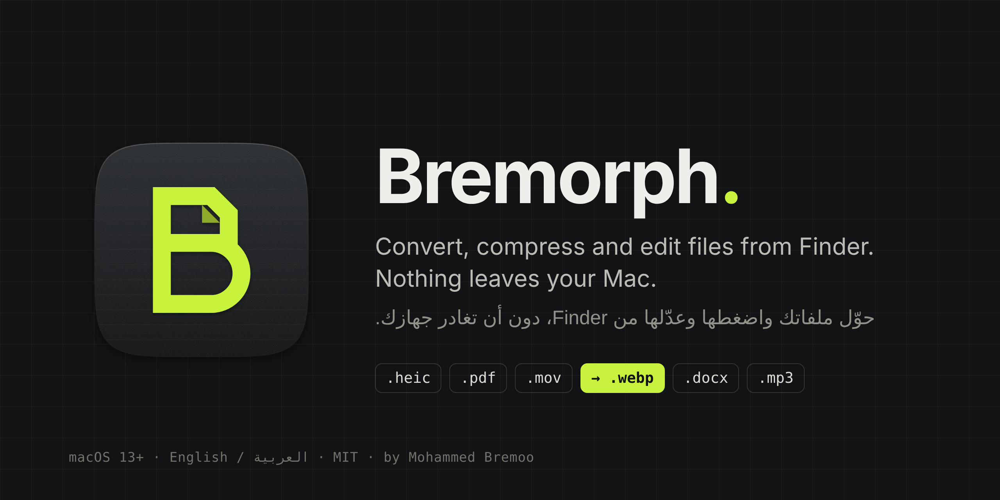
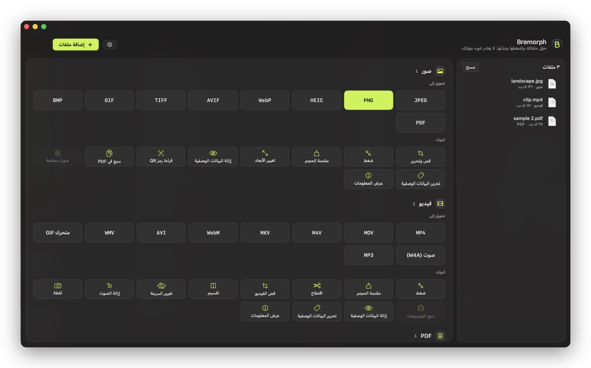
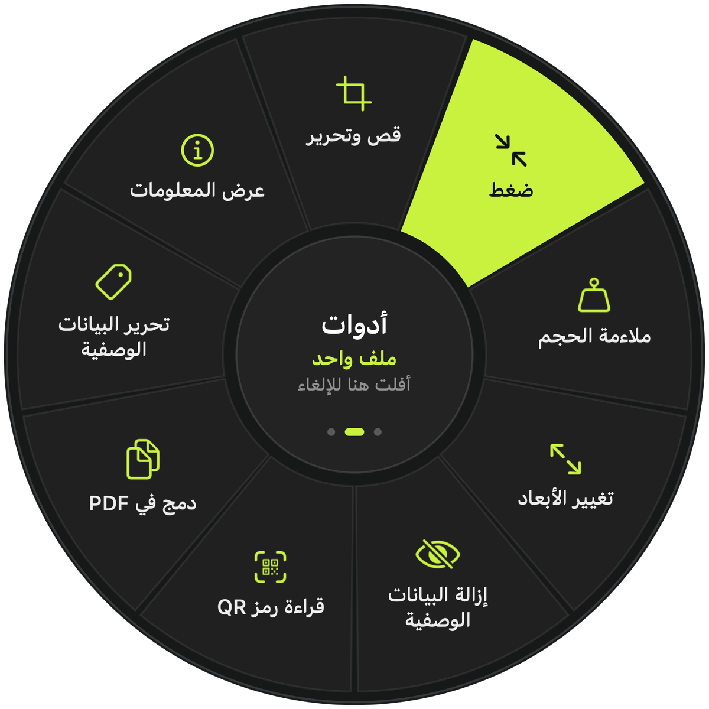
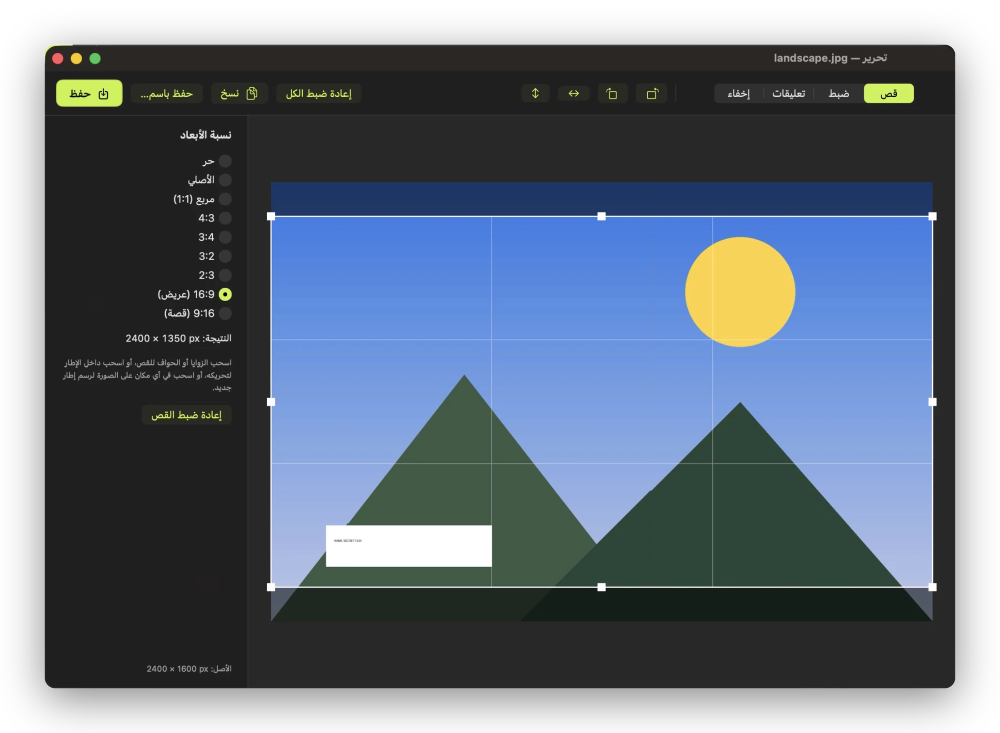
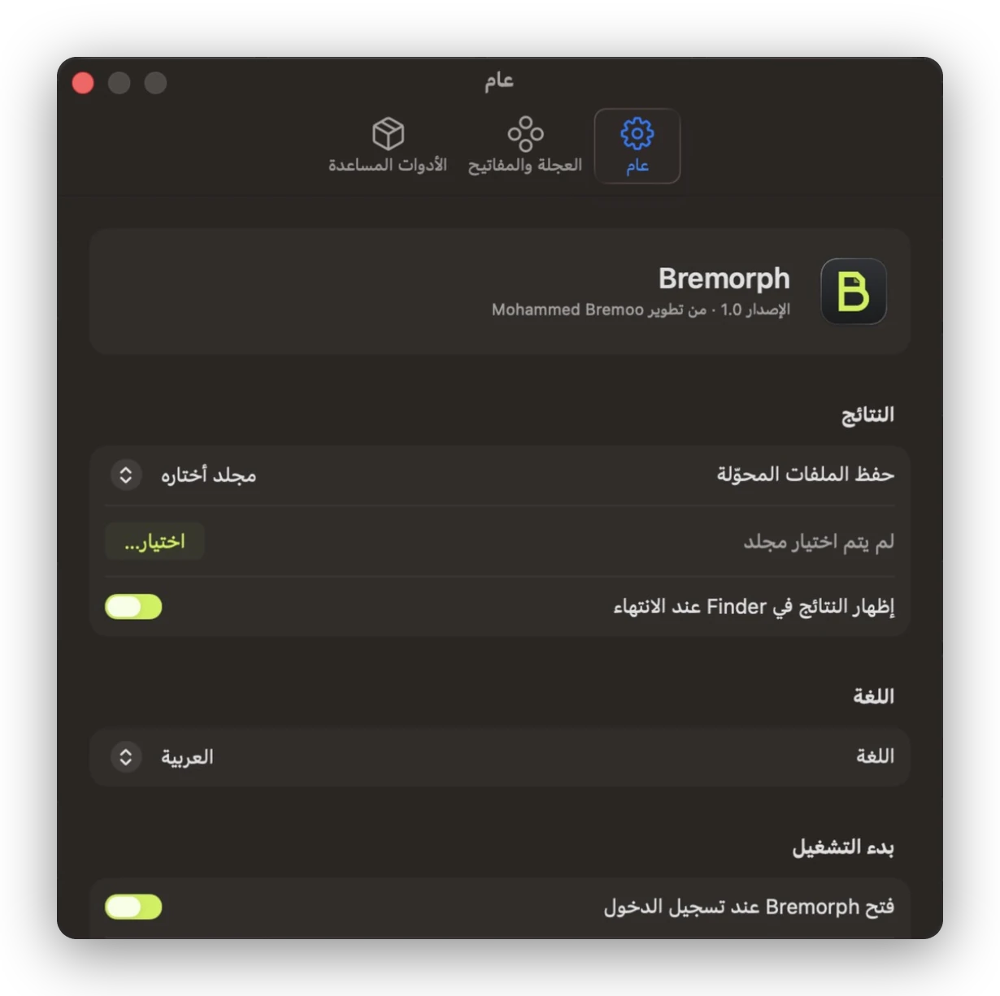

<p align="center">
  <a href="https://moha-bremoo.github.io/Bremorph/#ar"><b>الموقع</b></a> · <a href="README.md">English</a> · <b>العربية</b>
</p>

<p align="center">
  
</p>

<p align="center">
  
  
  
  
  
</p>

<div dir="rtl">

Bremorph يحوّل ملفاتك ويضغطها ويعدّلها من داخل Finder. ابدأ بسحب ملف واضغط Shift، فتظهر تحت المؤشر عجلة فيها الصيغ المتاحة. أفلت الملف على الصيغة التي تريدها، فتُحفظ النتيجة بجانب الملف الأصلي. لا يُرفع أي شيء إلى الإنترنت.

<p align="center">
  
</p>

## ماذا يقدّم

في Bremorph ‏95 إجراءً للصور والفيديو والصوت وملفات PDF والمستندات والعروض التقديمية وجداول البيانات والترجمات والأرشيفات. معظمها يعمل مباشرة بما هو موجود في macOS، وبعض الصيغ تحتاج أداة مساعدة مجانية مثل ffmpeg (انظر [الأدوات المساعدة](#أدوات-مساعدة-اختيارية)).

التطبيق مكتوب بلغة Swift باستخدام SwiftUI وAppKit وAVFoundation وImageIO وCore Image وPDFKit، ويعمل من شريط القوائم. الواجهة متوفرة بالعربية والإنجليزية، وتنعكس بالكامل من اليمين إلى اليسار عند اختيار العربية. يتبع التطبيق لغة جهازك، ويمكنك تغييرها من الإعدادات ← عام ← اللغة.

## العجلة



ابدأ بسحب ملف أو أكثر، ثم اضغط أحد المفاتيح:

| المفتاح | العجلة | ما فيها |
|---|---|---|
| ⇧ Shift | التحويل | كل صيغ الإخراج المناسبة لنوع الملف، مع «قص وتحرير» للصور |
| ⌘ Command | الأدوات | ضغط، ملاءمة الحجم، اقتطاع، قص، تقسيم، السرعة، البيانات الوصفية، تنظيم الصفحات وغيرها |
| ⌃ Control | الإجراءات | AirDrop، نسخ، نقل إلى، نسخ المسار، الطرفية، تثبيت عائم، ZIP، فتح في Bremorph |

بعد أن تظهر العجلة يمكنك ترك المفتاح ومتابعة السحب. للإلغاء أفلت الملف في منتصف العجلة.

إذا كانت الملفات محددة مسبقًا، اضغط ⌃⌥M فتظهر العجلة عند المؤشر. ويمكنك أيضًا تفعيل خيار *اضغط Return في Finder لفتح العجلة*. في هذه الحالة استخدم الفأرة، أو الأسهم ثم Return، أو الأرقام من 1 إلى 9.

يمكنك تغيير المفاتيح من الإعدادات ← العجلة والمفاتيح. ويقبل Bremorph أيضًا الملفات التي تُفلتها على أيقونته في Dock أو على نافذته الرئيسية، ويضيف «تحويل باستخدام Bremorph» و«قص وتحرير باستخدام Bremorph» إلى قائمة الخدمات في Finder.

<br clear="left">

## الصيغ

| النوع | يحوّل إلى |
|---|---|
| الصور | JPEG وPNG وHEIC وWebP وAVIF وTIFF وGIF وBMP وPDF. ويقرأ أيضًا SVG وRAW وغيرها. |
| الفيديو | MP4 وMOV وM4V وMKV وWebM وAVI وWMV وGIF متحرك، وصوت M4A وMP3 |
| الصوت | MP3 وM4A (AAC) وM4A بلا فقدان (ALAC) وWAV وAIFF وCAF وFLAC وOGG وOpus وWMA |
| PDF | Word (DOCX) وPages وPowerPoint وExcel وEPUB وMarkdown ونص عادي، وصفحات PNG أو JPEG بدقة 300 DPI |
| المستندات | PDF وDOCX وPages وMarkdown وEPUB وRTF وTXT وHTML وODT. ويقرأ قصاصات النص أيضًا. |
| العروض التقديمية | من PPT وPPTX وODP وKeynote إلى PDF أو PowerPoint أو PNG أو JPEG |
| جداول البيانات | من XLS وXLSX وODS وCSV وTSV وNumbers إلى XLSX أو ODS أو CSV أو TSV أو PDF |
| الترجمات | من SRT إلى WebVTT وبالعكس، أو إلى نص عادي |
| الأرشيفات | ينشئ ZIP وTAR.GZ، ويفك ZIP وTAR وGZ وBZ2 وRAR و7Z |

## الأدوات

للصور نافذة «قص وتحرير» فيها نسب أبعاد جاهزة، وتدوير وقلب، وضبط السطوع والتباين والتشبع، وتحسين تلقائي. في النافذة نفسها أدوات التعليقات (أسهم وخطوط وأشكال وقلم وتظليل ونص)، وأداة الإخفاء التي تغطي الوجوه أو الأرقام بمربع أسود أو بكسلات أو تغبيش. ويمكن أيضًا ضغط الصور، أو ملاءمتها لحجم ملف محدد أو نسبة مئوية، أو تغيير أبعادها، أو جمعها في صورة واحدة أو في ملف PDF، أو قراءة رموز QR منها.

الفيديو يمكن ضغطه (بما في ذلك HEVC)، أو ملاءمته لحجم محدد، أو اقتطاعه، أو قصه، أو تقسيمه، أو تسريعه وإبطاؤه، أو دمج عدة مقاطع، أو حذف الصوت أو البيانات الوصفية منه، أو حفظ لقطة منه. والصوت يمكن اقتطاعه، أو موازنة مستواه، أو حجب مقطع منه بصافرة، أو تحويله بين أحادي وستيريو.

منظّم صفحات PDF يعيد ترتيب الصفحات ويدوّرها ويحذفها ويكررها، ويدرج ملف PDF آخر. وأدوات PDF الأخرى تدمج وتفصل وتستخرج الصفحات وتضغط وتلائم الحجم وتدوّر.

محرّر البيانات الوصفية يعرض العنوان والفنان أو المؤلف والوصف وحقوق النشر والتاريخ والكلمات المفتاحية ويعدّلها، دون إعادة ترميز الصور. ويمكنه أيضًا حذف البيانات الوصفية كلها، بما فيها موقع GPS.

<p align="center">
  
  
</p>

## التثبيت

تحتاج إلى macOS 13 Ventura أو أحدث، وإلى أدوات سطر الأوامر من Apple (`xcode-select --install`). لا تحتاج إلى Xcode نفسه.

</div>

```bash
git clone https://github.com/Moha-Bremoo/Bremorph.git
cd Bremorph
./build.command          # أو انقر عليه مرتين في Finder
```

<div dir="rtl">

يجمّع السكربت التطبيق ويثبّته في `~/Applications/Bremorph.app` ثم يفتحه. على macOS 26 تستخدم اللوحات العائمة تصميم Liquid Glass، وعلى الإصدارات الأقدم تستخدم المواد الشفافة المعتادة في النظام.

### أدوات مساعدة اختيارية

هذه الأدوات المجانية تضيف صيغًا أخرى. يعثر عليها Bremorph بنفسه، وتعرض الإعدادات ← الأدوات المساعدة ما وجده منها.

| الأداة | ما تضيفه | التثبيت |
|---|---|---|
| ffmpeg | MP3 وOGG وOpus وWMA وMKV وWebM وAVI وWMV وAVIF وقص الفيديو، والملفات التي لا يفتحها macOS | `brew install ffmpeg` |
| LibreOffice | PowerPoint وExcel وODS/ODT وCSV/TSV، وأفضل جودة لتحويل Word ⇄ PDF | `brew install --cask libreoffice` |
| webp | حفظ WebP على إصدارات macOS التي لا تملك مُرمِّزًا مدمجًا | `brew install webp` |
| Pages وKeynote وNumbers | صيغ مستندات Apple | Mac App Store |

يثبّت `install-tools.command` أدوات Homebrew دفعة واحدة، ويعرض `check-tools.command` ما هو مثبّت.

### الأذونات

يسألك macOS في أول مرة يحفظ فيها Bremorph ملفًا في سطح المكتب أو المستندات أو التنزيلات. ويطلب Bremorph إذن الأتمتة للتحكم في Finder عند أول استخدام لـ ⌃⌥M (لمعرفة الملفات المحددة)، وللتحكم في Pages أو Keynote أو Numbers عند تحويل ملفاتها. أما إذن تسهيلات الاستخدام فلا يحتاجه إلا إذا فعّلت خيار مفتاح Return.

## سطر الأوامر

ملف التطبيق نفسه ينفّذ التحويلات من الطرفية:

</div>

```bash
B=~/Applications/Bremorph.app/Contents/MacOS/Bremorph
$B --list                              # كل الإجراءات مع معرّفاتها
$B --run vidWEBM ~/Movies/clip.mp4     # يكتب clip.webm بجانب الملف الأصلي
$B --run pdfDOCX report.pdf
$B --run vidJoin part1.mp4 part2.mkv   # الإجراءات التي تدمج تقبل عدة ملفات
```

<div dir="rtl">

يشغّل `test.command` ‏58 عملية تحويل على مجلد ملفات عينة اسمه `CLI Tests/`، وهو غير موجود في المستودع.

## التصميم

أسطح بلون الجرافيت ولون إبراز واحد هو الأخضر الليموني (`#C9F23E`). يظهر الليموني على الشيء الذي أنت على وشك استخدامه فقط: القسم الذي يقف عليه المؤشر في العجلة، والزر الرئيسي، وشريط التقدم. أسماء الصيغ مكتوبة بخط SF Mono لتبدو مثل امتدادات الملفات. والأيقونة حرف «B» نصفه العلوي صفحة مطوية الزاوية ونصفه السفلي دائري، وهذا بالضبط ما يفعله Bremorph بملفاتك. في الوضع الفاتح يتحول لون الإبراز إلى زيتوني داكن (`#475F00`) ليبقى النص مقروءًا.

## الترجمة

نصوص الواجهة مكتوبة بالإنجليزية في الشيفرة، وتُترجم عبر `Resources/<اللغة>.lproj`. لتصحيح ترجمة أو إضافة لغة:

1. عدّل `l10n/ar.json`، أو انسخه إلى `l10n/<رمز اللغة>.json` للغة جديدة.
2. شغّل `python3 l10n/extract.py` لعرض أي نص لم يُترجم بعد.
3. شغّل `python3 l10n/extract.py --build` لإعادة إنشاء ملفات `.lproj`، ثم `./build.command`.

صيغ الجمع مثل «%d ملفات» موجودة تحت `"plurals"` وتتبع قواعد كل لغة، وللعربية ست صيغ.

## الخصوصية

لا يحتوي Bremorph على أي شيفرة اتصال بالشبكة. تُقرأ الملفات وتُكتب على جهازك فقط، والأدوات المساعدة (ffmpeg وLibreOffice) تعمل محليًا أيضًا.

## المساهمة

البلاغات وطلبات الدمج مرحّب بها. الصيغ الجديدة واللغات الجديدة والمزيد من الاختبارات في `test.command` أماكن جيدة للبدء. راجع [CONTRIBUTING.md](CONTRIBUTING.md).

## المطوّر

من تطوير محمد بريمو (Mohammed Bremoo).

## الرخصة

[MIT](LICENSE). © 2026 Mohammed Bremoo.

</div>
