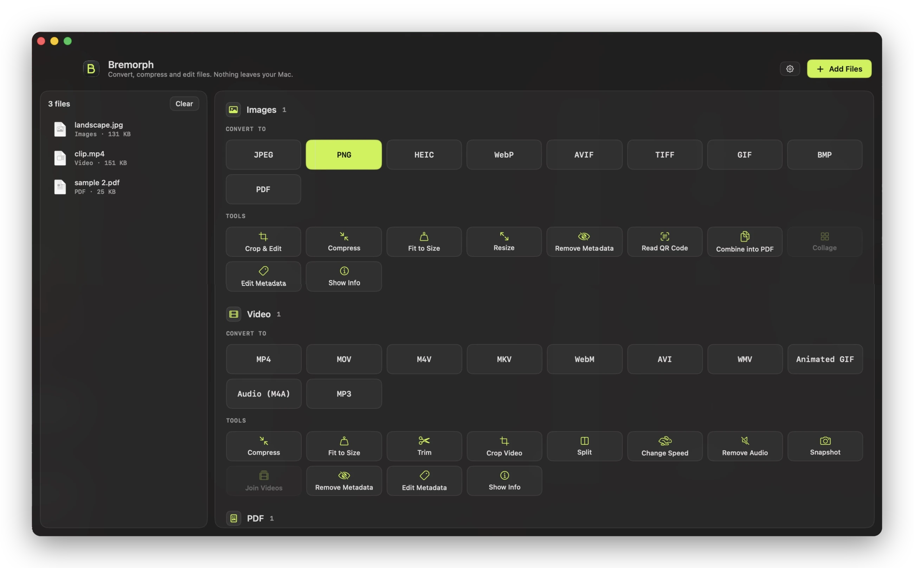
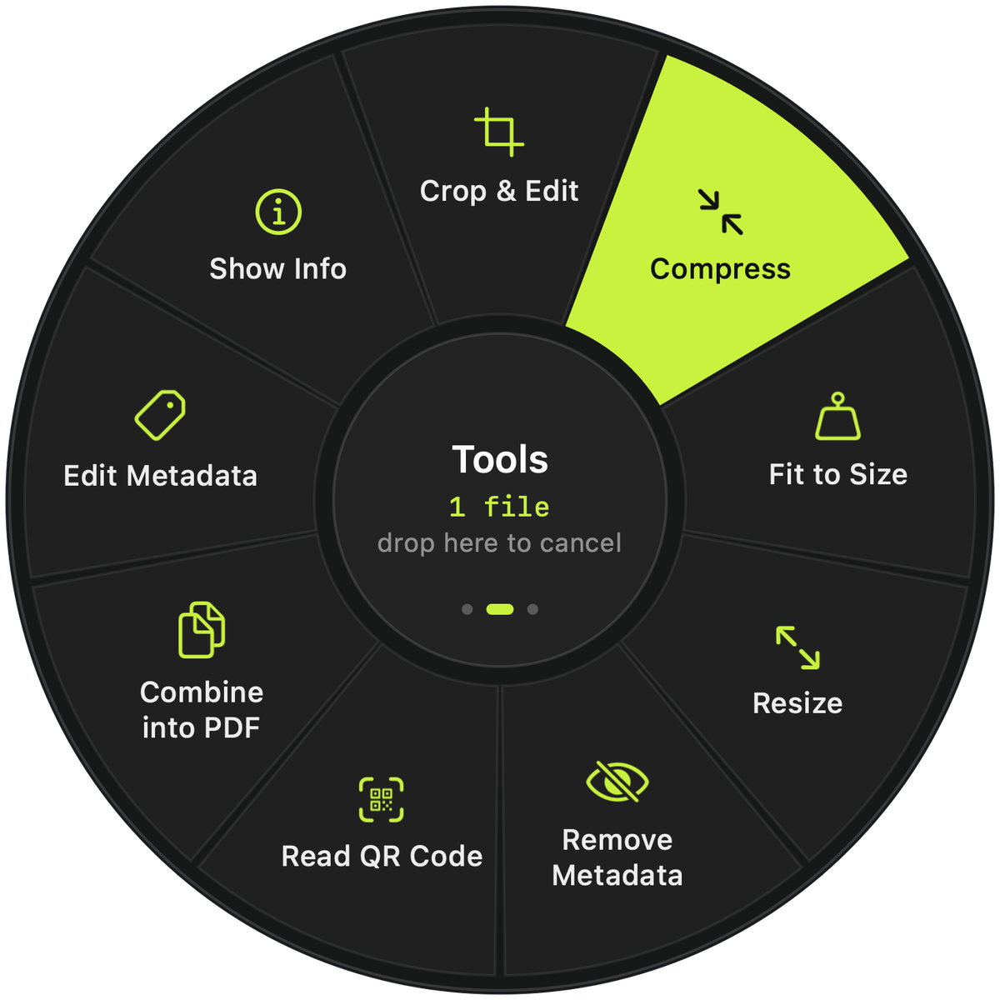
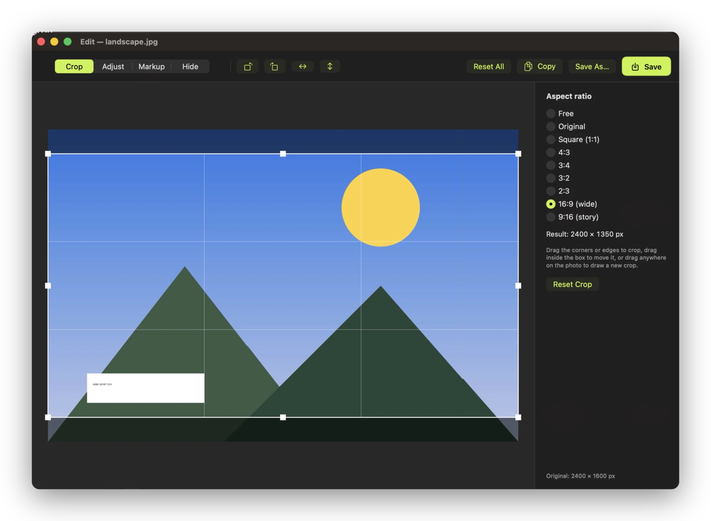
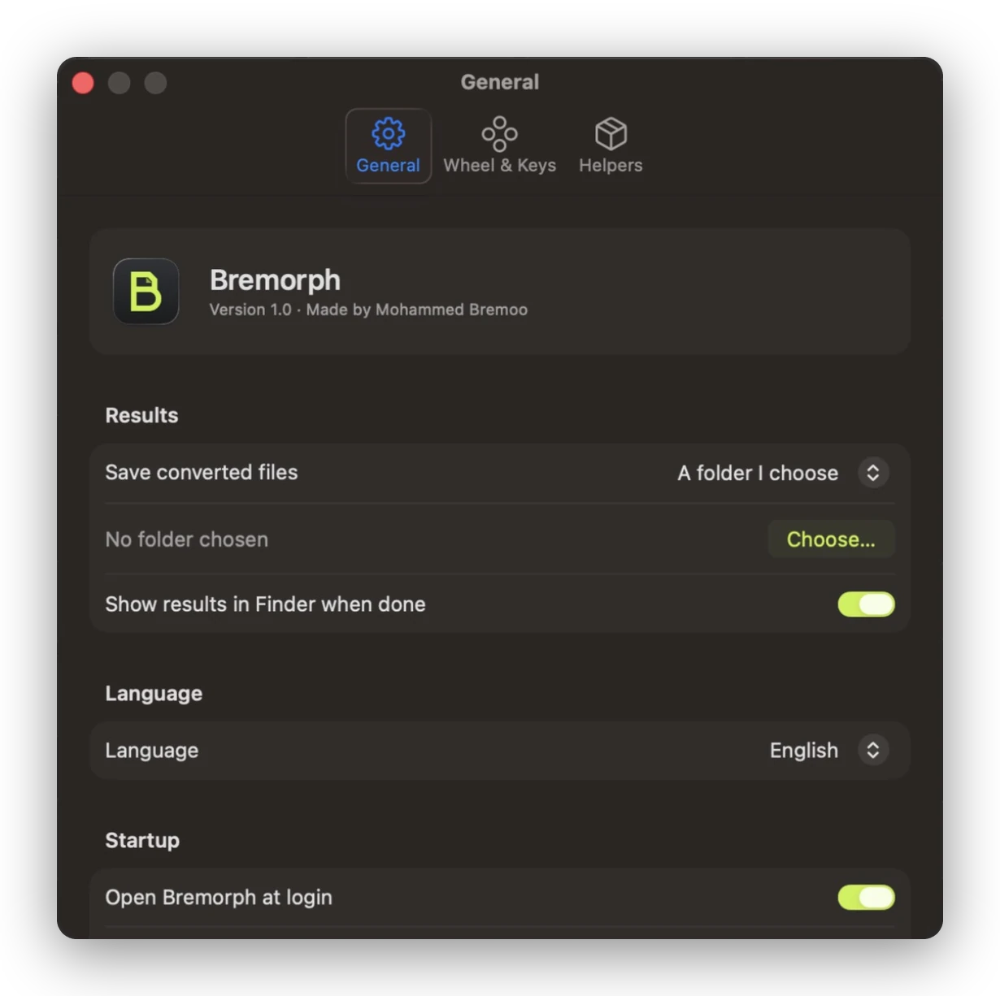

<p align="center">
  <a href="https://moha-bremoo.github.io/Bremorph/"><b>Website</b></a> · <b>English</b> · <a href="README.ar.md">العربية</a>
</p>

<p align="center">
  
</p>

<p align="center">
  
  
  
  
  
</p>

Bremorph converts, compresses and edits files from Finder. Start dragging a file, hold Shift, and a wheel of formats opens under your pointer. Drop the file on one and the result lands next to the original. Nothing is uploaded anywhere.

<p align="center">
  
</p>

## What you get

Bremorph has 95 actions for images, video, audio, PDFs, documents, slides, spreadsheets, subtitles and archives. Most of them work straight away with what macOS already has. A few formats need a free helper such as ffmpeg (see [Optional helpers](#optional-helpers)).

It's a native Swift app built on SwiftUI, AppKit, AVFoundation, ImageIO, Core Image and PDFKit, and it lives in the menu bar. The interface is available in English and Arabic, with a full right-to-left layout in Arabic. It follows your Mac's language, and you can change it in Settings → General → Language.

## The wheel



Start dragging one or more files, then hold a key:

| Key | Wheel | What's on it |
|---|---|---|
| ⇧ Shift | Convert | Every output format for that file type, plus Crop & Edit for images |
| ⌘ Command | Tools | Compress, Fit to Size, Trim, Crop, Split, Speed, Metadata, Organize Pages and more |
| ⌃ Control | Actions | AirDrop, Copy, Move To, Copy Path, Terminal, Float, ZIP, Open in Bremorph |

Once the wheel is open you can let go of the key and keep dragging. Drop on the centre to cancel.

If the files are already selected, press ⌃⌥M and the wheel opens at the pointer. You can also turn on *Press Return in Finder to open the wheel*. In this mode you can use the mouse, the arrow keys and Return, or the number keys 1 to 9.

The keys can be changed in Settings → Wheel & Keys. Bremorph also accepts files dropped on its Dock icon or main window, and adds *Convert with Bremorph* and *Crop & Edit with Bremorph* to Finder's Services menu.

<br clear="right">

## Formats

| Type | Converts to |
|---|---|
| Images | JPEG, PNG, HEIC, WebP, AVIF, TIFF, GIF, BMP, PDF. Also reads SVG, RAW and more. |
| Video | MP4, MOV, M4V, MKV, WebM, AVI, WMV, animated GIF, M4A and MP3 audio |
| Audio | MP3, M4A (AAC), M4A Lossless (ALAC), WAV, AIFF, CAF, FLAC, OGG, Opus, WMA |
| PDF | Word (DOCX), Pages, PowerPoint, Excel, EPUB, Markdown, plain text, PNG or JPEG pages at 300 DPI |
| Documents | PDF, DOCX, Pages, Markdown, EPUB, RTF, TXT, HTML, ODT. Also reads text clippings. |
| Slides | PPT, PPTX, ODP and Keynote to PDF, PowerPoint, PNG or JPEG |
| Spreadsheets | XLS, XLSX, ODS, CSV, TSV and Numbers to XLSX, ODS, CSV, TSV or PDF |
| Subtitles | SRT and WebVTT in both directions, or plain text |
| Archives | Creates ZIP and TAR.GZ. Extracts ZIP, TAR, GZ, BZ2, RAR and 7Z. |

## Tools

For images there's Crop & Edit with aspect presets, rotate, flip, brightness, contrast, saturation and auto-enhance. The same window has Markup (arrows, lines, shapes, pen, highlighter, text) and Hide, which covers faces or numbers with a black box, pixels or blur. Images can also be compressed, fitted to an exact file size or a percentage, resized, put in a collage, combined into a PDF, or scanned for QR codes.

Video can be compressed (HEVC included), fitted to a size, trimmed, cropped, split, sped up or slowed down, joined, or stripped of audio or metadata. You can also save a snapshot frame. Audio can be trimmed, normalized, bleeped over a section, or switched between mono and stereo.

The PDF organizer reorders, rotates, deletes and duplicates pages, and can insert another PDF. Other PDF tools merge, split, extract pages, compress, fit to size and rotate.

The metadata editor shows and edits title, artist or author, description, copyright, date and keywords, without re-encoding photos. It can also remove metadata entirely, including GPS location.

<p align="center">
  
  
</p>

## Install

**[Download Bremorph.dmg](https://github.com/Moha-Bremoo/Bremorph/releases/latest/download/Bremorph.dmg)**, open it, and drag Bremorph into Applications. It needs macOS 13 Ventura or later and runs on Apple silicon and Intel Macs.

The app isn't notarized by Apple yet, so the first time you open it macOS says it can't check it. Go to System Settings → Privacy & Security and click Open Anyway. You only do this once.

### Build from source

You need Apple's Command Line Tools (`xcode-select --install`). You don't need Xcode itself.

```bash
git clone https://github.com/Moha-Bremoo/Bremorph.git
cd Bremorph
./build.command          # or double-click build.command in Finder
```

The script compiles the app, installs it in `~/Applications/Bremorph.app` and opens it. `./build.command --universal` builds for both Apple silicon and Intel, and `./make-dmg.command` then packs that app into `build/Bremorph.dmg`. On macOS 26 the floating panels use Liquid Glass, and older versions use the standard translucent materials.

### Optional helpers

These free tools add formats. Bremorph finds them on its own, and Settings → Helpers shows which ones it found.

| Helper | Adds | Install |
|---|---|---|
| ffmpeg | MP3, OGG, Opus, WMA, MKV, WebM, AVI, WMV, AVIF, Crop Video, and files macOS can't open | `brew install ffmpeg` |
| LibreOffice | PowerPoint, Excel, ODS/ODT, CSV/TSV, and the best Word ⇄ PDF quality | `brew install --cask libreoffice` |
| webp | Saving WebP on macOS versions without a built-in encoder | `brew install webp` |
| Pages, Keynote, Numbers | Apple's document formats | Mac App Store |

`install-tools.command` installs the Homebrew helpers in one go, and `check-tools.command` lists what's installed.

### Permissions

macOS asks the first time Bremorph saves into Desktop, Documents or Downloads. Bremorph also asks for Automation access to Finder when you first use ⌃⌥M (to read the selection), and to Pages, Keynote or Numbers when you convert their files. Accessibility is needed only if you turn on the Return key option.

## Command line

The app binary runs the same conversions from the terminal:

```bash
B=~/Applications/Bremorph.app/Contents/MacOS/Bremorph
$B --list                              # every action and its id
$B --run vidWEBM ~/Movies/clip.mp4     # writes clip.webm next to the original
$B --run pdfDOCX report.pdf
$B --run vidJoin part1.mp4 part2.mkv   # combining actions take several files
```

`test.command` runs 58 conversions over a folder of sample files called `CLI Tests/`, which isn't part of the repo.

## Project layout

```
Sources/
  BremorphApp.swift     App, menu bar, Settings scene, Finder Services
  Brand.swift           Colour tokens, panels, buttons, keycaps
  Views.swift           Main window
  Wheel.swift           Drag detection, the wheel, Float shelf, progress toasts
  Actions.swift         File kinds and the list of actions
  Engine.swift          Dispatcher and output paths
  JobStore.swift        Job queue and progress
  ImageOps, VideoOps, AudioOps, PDFOps, DocOps, DocConvert, MediaFF
                        Conversions (system frameworks first, helpers when needed)
  ImageEditor.swift     Crop, adjust, markup, hide; also used for Crop Video
  PDFOrganizer.swift    Page organizer
  MetadataEditor.swift  Metadata viewer and editor
  Helpers.swift         ffmpeg, LibreOffice and iWork bridges, settings, Return-key tap
  SettingsView.swift    Settings window
  CLI.swift             Command-line mode
  Localization.swift    L() and LF(), language switch, right-to-left layout
Resources/              Menu-bar icon, en.lproj and ar.lproj
l10n/                   Translation sources (ar.json, en.json) and extract.py
AppIcon.iconset/        App icon
docs/brand/             make_brand.py renders the icon, menu-bar glyph and banner
```

## Design

Graphite surfaces with one accent colour, signal lime (`#C9F23E`). Lime marks whatever you're about to act on: the hovered slice of the wheel, the main button, progress. Format names are set in SF Mono so they read like file extensions. The icon is a "B" whose top half is a page with a folded corner and whose bottom half is round, which is what Bremorph does to your files. In light mode the accent switches to a dark olive (`#475F00`) so text stays readable.

## Translations

Interface text is written in English in the code and translated through `Resources/<language>.lproj`. To fix a translation or add a language:

1. Edit `l10n/ar.json`, or copy it to `l10n/<code>.json` for a new language.
2. Run `python3 l10n/extract.py` to list any text that isn't translated yet.
3. Run `python3 l10n/extract.py --build` to regenerate the `.lproj` files, then `./build.command`.

Plural forms such as "%d files" live under `"plurals"` and follow each language's rules. Arabic has six.

## Privacy

Bremorph has no network code. Files are read and written on your Mac only, and the helpers (ffmpeg, LibreOffice) run locally too.

## Contributing

Issues and pull requests are welcome. New output formats, new languages and more tests in `test.command` are good places to start. See [CONTRIBUTING.md](CONTRIBUTING.md).

## Author

Made by Mohammed Bremoo.

## License

[MIT](LICENSE). © 2026 Mohammed Bremoo.
